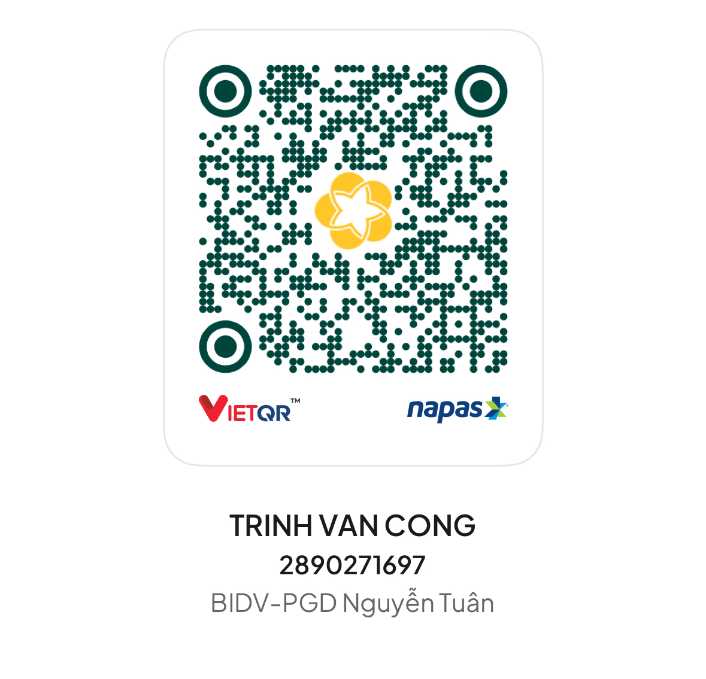

# claude-usage-bar

See your Claude Code usage limits in the macOS menu bar, for every account on your Mac.

```
C 87/88/94  T 79/17/0
```

Each letter is one account. The numbers are: 5-hour limit % / weekly limit % / Fable weekly limit %.
Orange at 70%, red at 90%. Click it to see account names and reset times.

## Install

1. Download **`Claude-Usage.dmg`** from [Releases](../../releases/latest).
2. Open it and double-click **`Cài đặt Claude Usage.command`**.
3. Follow the steps in the Terminal window.

If macOS blocks the file, go to **System Settings > Privacy & Security > Open Anyway**,
or run it in Terminal:

```sh
bash "/Volumes/Claude Usage/Cài đặt Claude Usage.command"
```

## Good to know

- Works with browser logins (`claude`) and `claude setup-token` tokens (aliases using
  `CLAUDE_CODE_OAUTH_TOKEN`). Accounts are found automatically.
- Refreshes every 3 minutes (or click "Làm mới ngay"), using a tiny 1-token request per account.
- New version available? The menu shows "Cập nhật ngay". One click updates it.
- Token not found? Add `name = /path/to/token-file` to `~/.config/claude-usage.conf`.
- Shows `?`: click it to see the error, or check `~/.cache/claude-usage/last-run.log`.

## Uninstall

Delete `~/.config/swiftbar/claude-usage.1m.py` (and the SwiftBar app if you don't need it).

## Support

Free for everyone. If it saves you some time, you can buy me a coffee by scanning this VietQR code
with any Vietnamese banking app:



BIDV - 2890271697 - TRINH VAN CONG

## Build

`./build.sh` creates `dist/Claude-Usage.dmg`. Built on [SwiftBar](https://github.com/swiftbar/SwiftBar).
MIT license.
